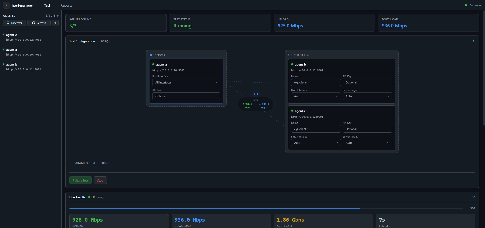
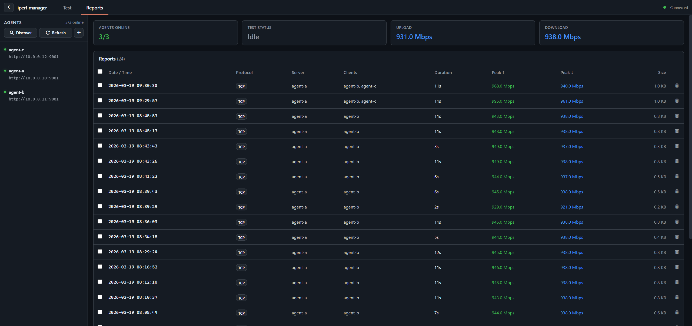

# iperf-manager

iperf-manager runs iperf3 tests between many hosts from one web page. It has two parts: lightweight **agents** on the hosts you want to test, and a **web dashboard** (Flask + React) that finds the agents, builds a server/client topology, starts tests and shows live throughput.

## Features

- Agent discovery by UDP broadcast or by configured IP ranges, plus manual add
- Drag-and-drop topology: one server agent, one or more client agents
- TCP and UDP tests in `bidirectional`, `upload` and `download` mode
- Live throughput charts over Socket.IO
- Scheduled tests with cron expressions
- Saved reports (CSV, HTML, ZIP) with an inline CSV viewer
- Dashboard login, on by default
- HTTPS between dashboard and agents with certificate pinning, and an API key per agent
- Remote agent update from the dashboard (opt-in per agent)
- Agent runtime without pip dependencies; installers for Linux (systemd) and Windows (scheduled task)

## Screenshots

These screenshots were captured from the live local web UI with agent names, IP addresses, and other environment-specific details redacted.

### Running Dashboard



### Reports View



## How it works

```text
Browser
  |  HTTP (port 5000)
  v
Web dashboard (Flask + React)
  |  REST over HTTPS (port 9001), discovery over UDP 9999
  +--> Agent A (iperf3 server)
  +--> Agent B..N (iperf3 clients)  ---- iperf3 traffic (5211+) ---->  Agent A
```

| Component | Description | Entry point |
|-----------|-------------|-------------|
| Agent | Headless REST service that starts and stops iperf3 servers and clients | `main_agent.py` |
| Web dashboard | Discovery, test control, live results, schedules and reports | `main_web.py` |

## Install

The commands below install the latest release. The [deployment guide](deploy/README-deploy.md) lists every option (ports, API key, version pinning, staged installs) and explains each step.

Set these variables once per Linux shell:

```bash
REPO="IT-BAER/iperf-manager"
REF="$(curl -fsSL "https://api.github.com/repos/${REPO}/releases/latest" | sed -n 's/.*"tag_name"[[:space:]]*:[[:space:]]*"\([^"]*\)".*/\1/p' | head -n1)"
REF="${REF:-main}"
```

### 1. Web dashboard (Linux)

```bash
curl -fsSL "https://raw.githubusercontent.com/${REPO}/${REF}/deploy/install-web-linux.sh" | sudo bash
```

Open `http://<server-ip>:5000` and log in as `admin` with the password that the installer prints. Save the password; it is shown only once.

### 2. Agents

Linux:

```bash
curl -fsSL "https://raw.githubusercontent.com/${REPO}/${REF}/deploy/install-agent-linux.sh" | sudo bash
```

Windows (PowerShell as Administrator):

```powershell
$ref = (Invoke-RestMethod -UseBasicParsing https://api.github.com/repos/IT-BAER/iperf-manager/releases/latest).tag_name
Invoke-WebRequest -UseBasicParsing "https://raw.githubusercontent.com/IT-BAER/iperf-manager/$ref/deploy/Install-Agent.ps1" -OutFile "$env:TEMP\Install-Agent.ps1"
powershell -NoProfile -ExecutionPolicy Bypass -File "$env:TEMP\Install-Agent.ps1"
```

Each agent installer prints an **API token** (only on the first install) and a **TLS SHA-256** fingerprint. Save both.

### 3. Connect the agents

1. In the dashboard, agents in the same subnet appear automatically. Add agents in other subnets with **Add Agent** (`https://<agent-ip>:9001`).
2. Click the key button on each agent row and paste its API token.
3. Hover over the agent URL and compare the fingerprint with the installer output.

To read a token later, see [Add agents to the dashboard](deploy/README-deploy.md#add-agents-to-the-dashboard).

## Update

| Component | How |
|-----------|-----|
| Web dashboard | `curl -fsSL "https://raw.githubusercontent.com/${REPO}/${REF}/deploy/install-web-linux.sh" \| sudo bash -s -- --update` |
| Linux agent | Run the install command again |
| Windows agent | Download and run the installer again |
| Any agent with remote update on | Click **Update** next to the agent in the dashboard ([details](deploy/README-deploy.md#remote-update-from-the-dashboard)) |

Updates keep the dashboard login, the agent API keys and all settings.

## Uninstall

| Component | Command |
|-----------|---------|
| Web dashboard | `curl -fsSL "https://raw.githubusercontent.com/${REPO}/${REF}/deploy/install-web-linux.sh" \| sudo bash -s -- --uninstall` |
| Linux agent | `sudo bash /opt/iperf-manager/deploy/install-agent-linux.sh --uninstall` |
| Windows agent | `powershell -NoProfile -ExecutionPolicy Bypass -File C:\iperf-manager\deploy\Install-Agent.ps1 -Uninstall` |

What each uninstall removes and keeps is listed in the [deployment guide](deploy/README-deploy.md).

## Network ports

| Port | Protocol | Direction | Purpose |
|------|----------|-----------|---------|
| 5000 | TCP | browser -> dashboard | Web dashboard |
| 9001 | TCP | dashboard -> agent | Agent REST API |
| 9999 | UDP | dashboard -> agent | Agent discovery |
| 5211 and up | TCP and UDP | client agent -> server agent | iperf3 test traffic, one port per client |

The agent installers open only the iperf3 ports `5211,5212` (two clients). For larger tests, see [Network ports and firewall](deploy/README-deploy.md#network-ports-and-firewall).

## Run a test

1. Drag one agent into the server zone and one or more agents into the client zone.
2. Choose protocol, mode, duration and advanced options.
3. Start the test and watch live upload and download throughput.
4. Open the **Reports** tab for saved results. Reports are stored under `data/` on the dashboard host.

To run tests on a schedule, use the **Scheduled Tests** panel: enter a name and a cron expression (5 fields: minute hour day month weekday), and choose a saved profile or a snapshot of the current settings (**Manual Snapshot**). Only one test runs at a time; a schedule that is due while another test runs is skipped.

| Dashboard mode | Description |
|----------------|-------------|
| `bidirectional` | Traffic in both directions at the same time (iperf3 `--bidir`, TCP only) |
| `upload` | Client to server |
| `download` | Server to client |

## Development

Requirements: Python 3.9 or later, `iperf3` on agent hosts, Node.js 20.19 or 22.12 or later for the frontend.

Run an agent from the checkout (without an API key it accepts every request; set `api_token` in its config, see [Agent configuration](deploy/README-deploy.md#agent-configuration)):

```bash
python main_agent.py --host 0.0.0.0 --port 9001
```

Run the dashboard:

```bash
pip install -r requirements.txt
python main_web.py --host 127.0.0.1 --port 5000
```

Without configured credentials, the dashboard prints a generated `admin` password that changes on every restart. Dashboard settings and environment variables are listed in [Dashboard settings](deploy/README-deploy.md#dashboard-settings).

Rebuild the frontend after changes in `web/frontend` (see [web/frontend/README.md](web/frontend/README.md)):

```bash
cd web/frontend
npm install
npm run build
```

If `web/frontend/dist/` is missing, Flask serves the older `web/templates/dashboard.html` page.

Run the tests:

```bash
python -m unittest discover -s . -p "test_*.py"
```

The dashboard starts a test with `POST /api/test/start`. Example body:

```json
{
  "server_agent": "server-agent-id",
  "duration_sec": 10,
  "base_port": 5211,
  "protocol": "tcp",
  "parallel": 1,
  "mode": "bidirectional",
  "clients": [
    { "agent": "client-agent-id", "name": "client-1" }
  ]
}
```

Optional fields: `server_bind`, `poll_interval_sec`, `omit_sec`, `bitrate`, `tcp_window`, and per client `server_target` and `bind`.

### Project layout

```text
iperf-manager/
  main_agent.py          agent entry point
  main_web.py            dashboard entry point
  requirements.txt
  core/
    agent_service.py     agent REST API, discovery responder, iperf3 processes
    agent_config.py      config.json merge used by the installers
    test_runner.py       test orchestration
    net_utils.py         HTTP client, TLS pinning
    csv_recorder.py, report.py, config_model.py, constants.py, helpers.py
  web/
    app.py               Flask API, Socket.IO, scheduler
    frontend/            React app (src/, dist/ after build)
    templates/, static/  fallback page
  deploy/
    install-web-linux.sh, setup-web-service.sh
    install-agent-linux.sh, Install-Agent.ps1
    agent-update.sh, Agent-Update.ps1
  tests/                 unittest suite
  data/                  reports and profiles (runtime)
```

## License

This project is released under the MIT License. See [LICENSE](LICENSE) for the full text.

<br>

## 💜 Support

If you like this Project, consider supporting this and future work, which heavily relies on coffee:

<div align="center">
<a href="https://www.buymeacoffee.com/itbaer" target="_blank"></a>
<br>
<a href="https://www.paypal.com/donate/?hosted_button_id=5XXRC7THMTRRS" target="_blank">Donate via PayPal</a>
</div>
